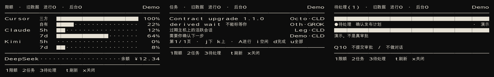
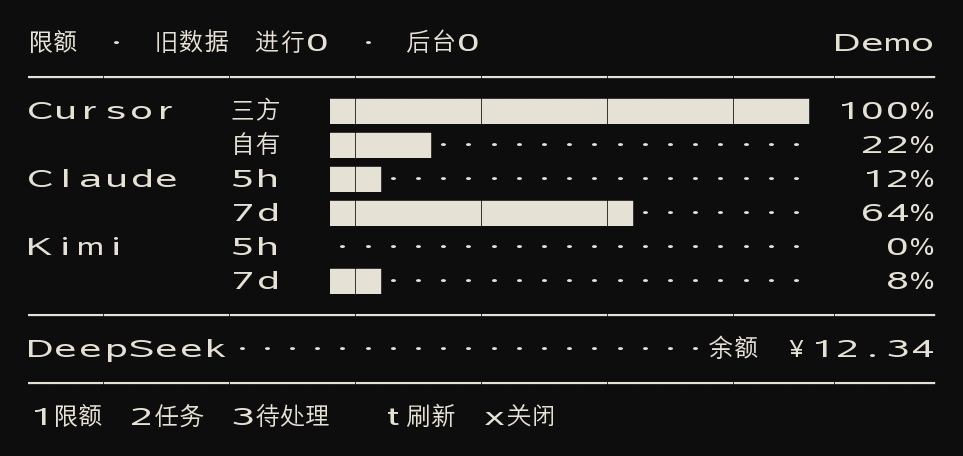
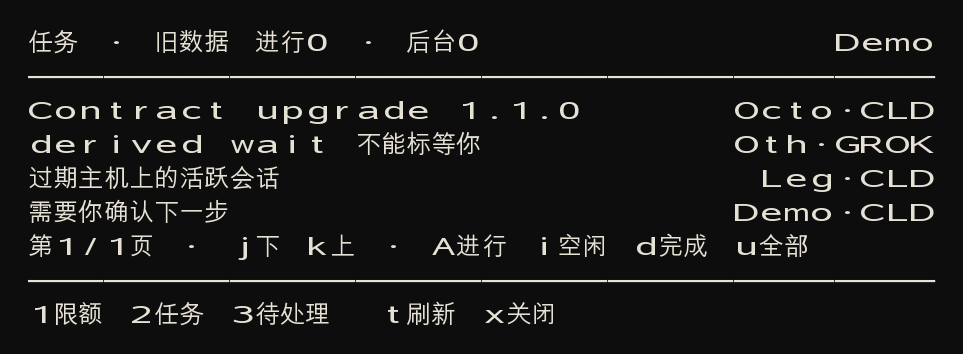
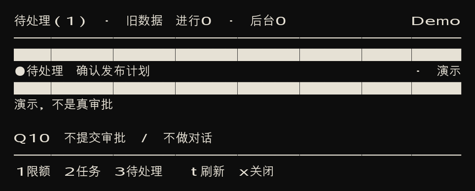
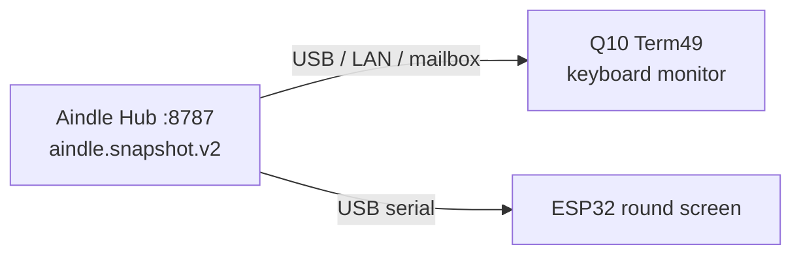

# Q10 Lab

**中文** · [English](#english)

2026 年在一台收藏级 **BlackBerry Q10（SQN100-3）** 上建立的 CLI-first BB10 / QNX 设备实验室。最终目标：让 Codex / Agent 能通过 USB SSH 把这台真机当 remote target 用。

A collector-grade **BlackBerry Q10 (SQN100-3)** lab for repeatable USB, `blackberry-deploy`, `blackberry-connect`, and SSH. The phone is an **interface**, not an intelligence: the keyboard monitor reads the same Aindle Hub snapshot as the ESP32 round screen, and does not run an LLM on QNX.

这是**单机实验室笔记**，不是通用刷机包，也不是 ESP32 圆屏仓库的分支。密码、IMEI、token 不进本仓库。

This is a single-device lab notebook, not a generic flashing kit, and not a fork of the ESP32 round-screen project. Passwords, IMEI, and tokens stay out of Git.

<p align="center">
  
</p>

上图由仓库内 `--demo` 夹具直接渲染，对应真机 Term49 的三页：限额 / 任务 / 待处理。真机实拍可以后补到 `docs/images/`。

The strip above is rendered from the in-repo `--demo` fixture — the same three Term49 pages you get on device: quota, tasks, and attention. Real-phone photos can be dropped into `docs/images/` later.

| 限额 Quota | 任务 Tasks | 待处理 Attention |
| :---: | :---: | :---: |
|  |  |  |



---

## 中文

### 这是做什么的

Q10 在这套系统里只负责**看和按**：720×720 屏幕 + 物理键盘，读 Mac 上 Aindle Hub 的同一份 `aindle.snapshot.v2`（默认 `8787`）。不在 QNX 上跑 ChatGPT、Whisper 或本机模型。

已经打通的能力：

1. **可重复的 USB 实验室** — macOS 原生识别 `Hardware Port: BlackBerry`，不用 BlackBerry Link，也不把 USB 放进 WSL。
2. **官方 host tools 包装** — `blackberry-deploy` / `blackberry-connect` + 现代 OpenSSH 能对上 QNX OpenSSH 6.2 的参数。
3. **Term49 + BerryCore userland** — 真机终端和 `curl` / `git` / `qpkg`（无 root，不装 Berry Browser）。
4. **键盘 AI Monitor** — 主屏 `Z` 打开 Term49 后看限额、任务、待处理；USB / 同屋 Wi-Fi / 异地信箱自动换源。

圆屏继续走 LVGL / USB CDC-ACM。两边**只在 host 侧的 Agent 事件模型上共用底座**，见 [docs/SHARED_FOUNDATION.md](docs/SHARED_FOUNDATION.md)。

### 当前状态

**Phase 1 完成**（tag `q10-clean-baseline`）。真机已装 Term49 0.4.1.7、BerryCore v0.90.1、键盘监视器。未批准禁止 wipe / Autoloader / 升降级 / root。Berry Browser 要 root，不装。

| 项 | 值 |
|---|---|
| 设备 | BlackBerry Q10 / SQN100-3 |
| OS | BB10 10.3.3.3216 / QNX 8.0.0 |
| Host | macOS（Apple Silicon + Rosetta） |
| 监视器 | `ai-terminal/q10_monitor.py`（设备上库存 `python3.2`） |
| Hub | 只读 Aindle `8787`，回退探测 `8790`；本仓库不另起 Hub |

### 安全红线

未获当面批准，禁止：Security Wipe、Factory Reset、Autoloader、OS 升降级、root、改 NVRAM / radio / bootloader、wipe filesystem、删除系统应用。研究恢复路线 ≠ 执行。见 [docs/RECOVERY.md](docs/RECOVERY.md)。

密码只通过 prompt 或已 gitignore 的 `local-config/device.env`。不要把它贴进聊天或 commit。

### 快速开始

手机需打开 Developer Mode，并已设好设备密码。

```sh
./scripts/q10-detect.sh
./scripts/q10-apps.sh
./scripts/q10-connect.sh
./scripts/q10-health.sh
./scripts/q10-shell.sh            # USB SSH
./scripts/q10-send.sh             # 把脚本推到 /var/tmp，可选 --run
./scripts/q10-monitor.sh --local  # Mac 预览同一份 8787
./scripts/q10-monitor.sh --local --demo   # 不连 Hub，打演示三页
./scripts/q10-monitor.sh          # 推到手机并用 USB SSH 打一屏
./scripts/q10-mailbox-push.sh --loop      # 异地：把 8787 推到信箱
./scripts/q10-launch.sh           # 把 Term49 拉到前台
```

主屏一键请用 **`Z` → Term49**（`1` / `W` 出厂是语音信箱）。详见 [docs/LAUNCH.md](docs/LAUNCH.md)。

Term49 里：

```sh
/accounts/1000/shared/misc/q10mon
. /accounts/1000/shared/misc/q10-autostart.sh   # 一次：以后打开 Term49 就进监视器
```

| 键 | 不按 Alt | 页 |
|---|---|---|
| `1` | `W` | 限额 |
| `2` | `E` | 任务（`a` 进行 / `i` 空闲 / `d` 完成 / `u` 全部） |
| `3` | `R` | 待处理 |
| `4` | `S` | 同待处理 |
| `t` | | 刷新 |
| `j` / `k` | | 翻页 |
| `x` | | 退出监视器（不换字体） |

口径测试（Mac）：

```sh
cd ai-terminal && python3 -m unittest test_q10_monitor.py
```

重新生成 README 里的演示图：

```sh
python3 scripts/q10-render-demo.py
```

### 目录

| 路径 | 用途 |
|---|---|
| `docs/` | 来源、基线、USB 链、恢复、启动、信箱、与圆屏的共用底座 |
| `docs/images/` | README 演示图；真机实拍也可放这里 |
| `scripts/` | 检测 / 连接 / 部署 / 健康检查 / 监视器推送（另有 `.ps1` 备援） |
| `ai-terminal/` | 键盘 AI Monitor（python3.2 TUI，读 8787） |
| `mailbox/` | 异地只读快照 Worker（HTTPS + token） |
| `checksums/` | 安装包期望哈希；BAR / zip 不进 Git |
| `baselines/` | 干净基线与应用清单 |
| `downloads/` | 已校验的安装包与 BAR，不提交 |
| `logs/` | 探测与安装日志，不提交 |
| `tools/bb10/` | 解压后的 host tools，不提交（包装脚本在仓内） |
| `local-config/` | 密码、token、本机字体，不提交 |

更细的笔记：[USB](docs/USB.md) · [Bring-up](docs/BRINGUP.md) · [基线](docs/Q10_BASELINE.md) · [Golden](docs/GOLDEN_BASELINE.md) · [BerryCore](docs/BERRYCORE.md) · [监视器选项](docs/AI_TERMINAL_OPTIONS.md) · [信箱](docs/MAILBOX.md) · [来源](docs/SOURCES.md)

---

## English

### What this is

Q10 Lab is a **repeatable, CLI-first lab** around one collector-grade BlackBerry Q10. The phone is the **interface**: a 720×720 screen and a hardware keyboard that displays the same `aindle.snapshot.v2` the Mac Aindle Hub already serves (default port `8787`). It is not a tiny ChatGPT. Nothing here runs Whisper or an LLM on QNX.

What already works on this device:

1. **Repeatable USB lab** — macOS natively shows `Hardware Port: BlackBerry`. No BlackBerry Link. Do not put USB inside WSL.
2. **Wrapped official host tools** — `blackberry-deploy` / `blackberry-connect`, plus OpenSSH settings that actually talk to QNX OpenSSH 6.2.
3. **Term49 + BerryCore userland** — on-device terminal plus `curl` / `git` / `qpkg`. No root. No Berry Browser.
4. **Keyboard AI Monitor** — press `Z` on the home screen to open Term49, then read quota, tasks, and attention. The client fails over USB → same-LAN Wi-Fi → a remote mailbox without restarting.

The ESP32 round screen stays on LVGL / USB CDC-ACM. The two devices share only the **host-side agent event model**. See [docs/SHARED_FOUNDATION.md](docs/SHARED_FOUNDATION.md).

### Status

**Phase 1 is done** (tag `q10-clean-baseline`). Term49 0.4.1.7, BerryCore v0.90.1, and the keyboard monitor are installed. Wipe / Autoloader / OS up-down / root stay forbidden until explicitly approved. Berry Browser needs root and is not installed.

| Item | Value |
|---|---|
| Device | BlackBerry Q10 / SQN100-3 |
| OS | BB10 10.3.3.3216 / QNX 8.0.0 |
| Host | macOS (Apple Silicon + Rosetta) |
| Monitor | `ai-terminal/q10_monitor.py` (stock `python3.2` on device) |
| Hub | Read-only Aindle `8787`, probe fallback `8790`; this repo does not start another Hub |

### Safety

Do not run any of the following without an in-person yes: Security Wipe, Factory Reset, Autoloader, OS upgrade/downgrade, root, NVRAM / radio / bootloader edits, filesystem wipe, or removal of system apps. Researching a recovery path is not permission to execute it. See [docs/RECOVERY.md](docs/RECOVERY.md).

Passwords are prompted or read from gitignored `local-config/device.env`. Do not paste them into chat or commits.

### Quick start

Enable Developer Mode on the phone and set a device password first.

```sh
./scripts/q10-detect.sh
./scripts/q10-apps.sh
./scripts/q10-connect.sh
./scripts/q10-health.sh
./scripts/q10-shell.sh            # USB SSH
./scripts/q10-send.sh             # push a script to /var/tmp, optional --run
./scripts/q10-monitor.sh --local  # Mac preview of the same 8787 hub
./scripts/q10-monitor.sh --local --demo   # fixture pages, no live hub
./scripts/q10-monitor.sh          # push to the phone and print one frame over USB SSH
./scripts/q10-mailbox-push.sh --loop      # away-from-home: publish 8787 to the mailbox
./scripts/q10-launch.sh           # bring Term49 to the foreground
```

On the home screen, bind **`Z` → Term49**. Factory `1` / `W` is voicemail. Details: [docs/LAUNCH.md](docs/LAUNCH.md).

Inside Term49:

```sh
/accounts/1000/shared/misc/q10mon
. /accounts/1000/shared/misc/q10-autostart.sh   # once: open Term49 straight into the monitor
```

| Key | Without Alt | Page |
|---|---|---|
| `1` | `W` | Quota |
| `2` | `E` | Tasks (`a` active / `i` idle / `d` done / `u` all) |
| `3` | `R` | Attention |
| `4` | `S` | Same attention page |
| `t` | | Refresh |
| `j` / `k` | | Page through long lists |
| `x` | | Leave the monitor (does not change the font) |

Contract tests on the Mac:

```sh
cd ai-terminal && python3 -m unittest test_q10_monitor.py
```

Regenerate the README demo strip:

```sh
python3 scripts/q10-render-demo.py
```

### Layout

| Path | Role |
|---|---|
| `docs/` | Sources, baselines, USB path, recovery, launch, mailbox, shared host model |
| `docs/images/` | README demos; real-device photos can live here too |
| `scripts/` | Detect / connect / deploy / health / monitor push (`.ps1` fallbacks exist) |
| `ai-terminal/` | Keyboard AI Monitor (python3.2 TUI, reads 8787) |
| `mailbox/` | Read-only remote snapshot Worker (HTTPS + token) |
| `checksums/` | Expected hashes; BAR / zip files stay out of Git |
| `baselines/` | Clean baseline and app lists |
| `downloads/` | Verified installers and BARs, not committed |
| `logs/` | Probe and install logs, not committed |
| `tools/bb10/` | Extracted host tools, not committed (wrappers are in-tree) |
| `local-config/` | Passwords, tokens, local fonts, not committed |

Deeper notes: [USB](docs/USB.md) · [Bring-up](docs/BRINGUP.md) · [Baseline](docs/Q10_BASELINE.md) · [Golden](docs/GOLDEN_BASELINE.md) · [BerryCore](docs/BERRYCORE.md) · [Monitor options](docs/AI_TERMINAL_OPTIONS.md) · [Mailbox](docs/MAILBOX.md) · [Sources](docs/SOURCES.md)

r6 隔离候选的 Octoooo 只读输入、测试与恢复边界见 [Q10 profile](docs/r6-device-profile.md)。不改变原仓正在使用的 Term49 配置。
